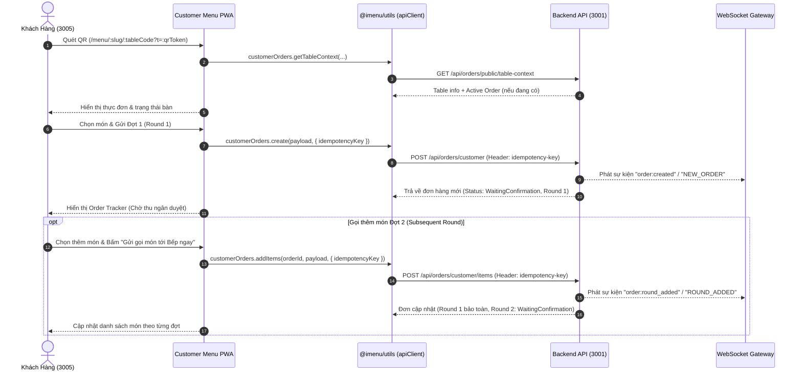
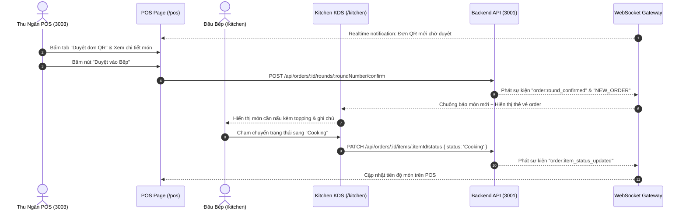
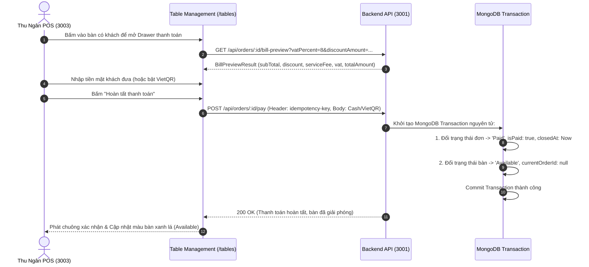
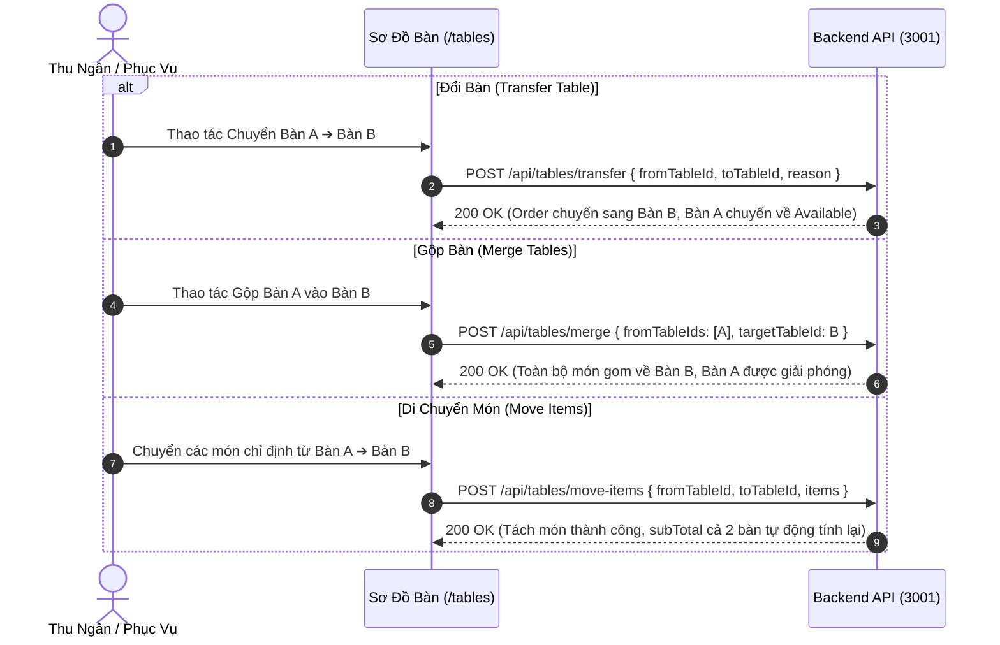
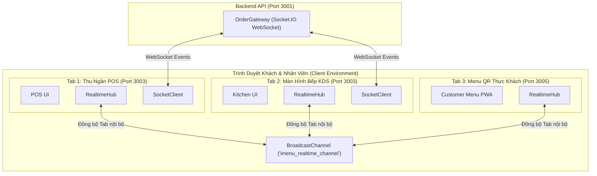
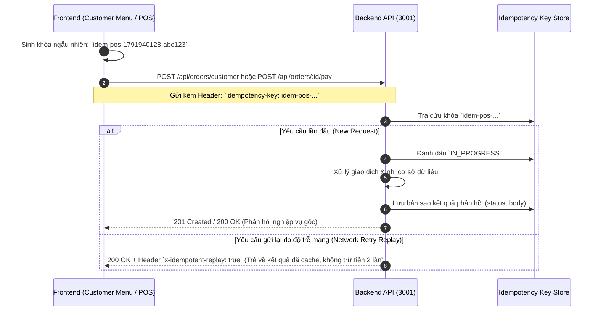

# 🍽️ iMenu — Nền Tảng Quản Lý Nhà Hàng & Menu Điện Tử Thế Hệ Mới (Frontend Monorepo)

*Đọc tài liệu bằng tiếng Anh: [English README (Tài liệu Tiếng Anh)](README_en.md)*

Hệ thống mã nguồn **Frontend Monorepo** toàn diện cho nền tảng **iMenu** (F&B All-in-One SaaS: Gọi món QR tại bàn đa đợt, POS Thu ngân duyệt đơn & tính tiền, Màn hình Bếp KDS Real-time WebSocket, Sơ đồ Bàn trực quan & Nghiệp vụ Bàn nâng cao, Thanh toán VietQR & Tiền mặt chuẩn xác, In hóa đơn nhiệt 80mm & Quản lý Chuỗi Đa Chi Nhánh), được xây dựng theo chuẩn kiến trúc **Turborepo** và **npm workspaces** đồng bộ với các tiêu chuẩn thiết kế công nghiệp hiện đại.

Kho mã nguồn chính thức: [https://github.com/thong21112001/imenu-menudientu.git](https://github.com/thong21112001/imenu-menudientu.git)

---

## 📁 1. Cấu Trúc Dự Án (Monorepo Directory Structure)

```text
imenu-menudientu/
├── apps/
│   ├── imenu-admin/            # Quản trị Nhà hàng, Thu ngân POS, Bếp KDS, Sơ đồ Bàn, In QR & Hóa đơn 80mm (Port 3003)
│   ├── imenu-client-web/       # Landing Page SaaS Marketing, Giới thiệu Tính năng, Bảng giá & Onboarding (Port 3004)
│   └── imenu-customer-menu/    # Web App Gọi món QR tại bàn Mobile-First PWA, Đa đợt & Theo dõi bếp (Port 3005)
│
├── packages/
│   ├── ui/                     # Design System dùng chung: Button, Card, Modal, StatusChip, Toast (@imenu/ui)
│   ├── utils/                  # SDK Client (apiClient), RealtimeHub, SocketClient, VietQR, Storage (@imenu/utils)
│   ├── types/                  # TypeScript Models & Interfaces dùng chung: Order, Table, User, Menu (@imenu/types)
│   ├── typescript-config/      # Cấu hình TypeScript chia sẻ (@imenu/typescript-config)
│   └── eslint-config/          # Cấu hình ESLint chia sẻ (@imenu/eslint-config)
│
├── scripts/
│   ├── e2e-order-lifecycle.mjs # Kịch bản kiểm thử E2E trình duyệt POS Order Lifecycle (9 Checkpoints)
│   ├── e2e-kds-lifecycle.mjs   # Kịch bản kiểm thử E2E KDS trình duyệt điều phối món ăn (6 Checkpoints)
│   └── capture-guide-screenshots.mjs # Tiện ích chụp ảnh màn hình tài liệu
│
├── test-artifacts/             # Thư mục lưu vết lỗi và bằng chứng kiểm thử E2E (ảnh chụp màn hình)
├── turbo.json                  # Cấu hình Turborepo Pipeline & Caching
└── package.json                # Root package.json quản lý workspaces & điều phối lệnh
```

---

## 🚀 2. Danh Sách Ứng Dụng & Cổng Khởi Chạy (Apps & Ports)

| Ứng dụng | Package Name | Cổng mặc định | Công nghệ chính | Mục đích & Nghiệp vụ |
| :--- | :--- | :--- | :--- | :--- |
| **Merchant Admin & POS** | `@imenu/admin` | `http://localhost:3003` | Next.js 15, React 19, Tailwind v4, Lucide | Quản lý Sơ đồ bàn, POS thu ngân, Hàng đợi duyệt đơn QR, Màn hình Bếp KDS Real-time WebSocket, Xem trước hóa đơn VAT, In hóa đơn nhiệt 80mm, In Standee/Sticker QR, Báo cáo doanh thu & Phân quyền RBAC đa chi nhánh |
| **SaaS Landing & Onboarding** | `@imenu/client-web` | `http://localhost:3004` | Next.js 15, React 19, Tailwind v4, Framer Motion | Landing Page giới thiệu giải pháp F&B, bảng giá 3 gói dịch vụ, đăng ký nhà hàng mới & luồng onboarding trực quan |
| **Customer QR Menu** | `@imenu/customer-menu` | `http://localhost:3005` | Next.js 15, React 19, Tailwind v4, VietQR | Web App gọi món QR tại bàn trên di động: Tùy chọn Topping/Size, Giỏ hàng nổi, Gọi món nhiều đợt (multi-round), Theo dõi tiến độ bếp realtime & Thanh toán VietQR / Tiền mặt |

---

## 🛠️ 3. Yêu Cầu Môi Trường (Prerequisites)

- **Node.js**: `>= 20.x` (khuyến nghị Node.js 20 LTS hoặc Node.js 22 LTS)
- **Package Manager**: `npm >= 10.x` (khuyến nghị npm 11.x)
- **Backend API**: `imenu-api` đang khởi chạy tại `http://localhost:3001` (NestJS 11 + MongoDB Mongoose 8)
- **Trình duyệt Google Chrome**: Đã cài đặt trên máy để thực thi bộ kiểm thử tự động E2E Puppeteer
- **Turborepo**: Được tích hợp sẵn trong `devDependencies`, tự động điều phối lệnh thông qua npm

---

## 💻 4. Hướng Dẫn Cài Đặt & Khởi Chạy Nhanh (Quick Start)

### Bước 1: Cài đặt Dependencies

Tại thư mục gốc của `imenu-menudientu`:

```bash
npm install
```

### Bước 2: Cấu hình Biến Môi Trường & Bảo Mật Xác Thực (Environment Variables & Credentials Security)

Sao chép tệp cấu hình mẫu `.env.example` sang `.env` hoặc `.env.local` tương ứng cho từng ứng dụng:

```bash
# Cấu hình môi trường cho thư mục gốc Monorepo (chạy bộ test E2E)
cp .env.example .env

# Cấu hình môi trường cho ứng dụng Quản trị & POS
cp apps/imenu-admin/.env.example apps/imenu-admin/.env.local

# Cấu hình môi trường cho Landing Page & Onboarding
cp apps/imenu-client-web/.env.example apps/imenu-client-web/.env.local
```

#### Cấu hình mẫu gốc (`.env.example`):
```env
# API & Application Base URLs
API_BASE_URL=http://localhost:3001/api
ADMIN_BASE_URL=http://localhost:3003
MENU_BASE_URL=http://localhost:3005

# Thông tin tài khoản trải nghiệm phục vụ kịch bản kiểm thử E2E
DEMO_USER_EMAIL=owner@sample.vn
DEMO_USER_PASSWORD=your_demo_password_here

# Mật khẩu demo tự động điền phía client (tùy chọn cho local testing)
NEXT_PUBLIC_DEMO_PASSWORD=your_demo_password_here
```

#### Cấu hình ứng dụng Admin POS (`apps/imenu-admin/.env.local`):
```env
NEXT_PUBLIC_API_URL=http://localhost:3001/api
NEXT_PUBLIC_SOCKET_URL=http://localhost:3001
NEXT_PUBLIC_WS_URL=http://localhost:3001
NEXT_PUBLIC_CUSTOMER_MENU_URL=http://localhost:3005
NEXT_PUBLIC_DEMO_PASSWORD=your_local_demo_password
```

> [!IMPORTANT]
> **Quy Tắc Bảo Mật & Phòng Chống Cảnh Báo Khi Gộp Nhánh Main**:
> - Toàn bộ mã nguồn Git-tracked **tuyệt đối không hardcode mật khẩu**.
> - Các tệp `.env.example` chỉ chứa placeholder (`your_demo_password_here`), an toàn 100% khi commit lên Git và vượt qua các bộ kiểm tra Secret Scanning (GitHub Secret Scanning, TruffleHog, SonarQube).
> - Khi phát triển cục bộ, lập trình viên đặt mật khẩu thật trong các tệp `.env` hoặc `.env.local` (được bảo vệ bởi `.gitignore`).
> - Khi triển khai môi trường Production, không thiết lập biến `NEXT_PUBLIC_DEMO_PASSWORD` để đảm bảo form đăng nhập không tự động điền mật khẩu.

### Bước 3: Khởi Chạy Máy Chủ Phát Triển (Development Servers)

Khởi chạy đồng thời cả 3 ứng dụng thông qua Turborepo:

```bash
npm run dev
```

Hoặc khởi chạy riêng từng ứng dụng theo nhu cầu:

```bash
# 1. Merchant Admin Hub & POS Thu Ngân (Cổng 3003)
npm run dev:admin

# 2. SaaS Landing Page & Onboarding (Cổng 3004)
npm run dev:client

# 3. Customer QR Menu Mobile PWA (Cổng 3005)
npm run dev:menu
```

### Bước 4: Xây Dựng Bản Production (Build)

```bash
# Xây dựng toàn bộ các ứng dụng và thư viện dùng chung
npm run build

# Xây dựng riêng lẻ từng ứng dụng
npm run build:admin
npm run build:client
npm run build:menu
```

---

## ⚡ 5. Vận Hành Đơn Hàng & POS Toàn Diện (Phase 6 Highlights)

Phase 6 hoàn thiện trọn vẹn chu trình vận hành F&B từ thực khách đến thu ngân và bếp:

### 1. Gọi Món QR Tại Bàn Nhiều Đợt (Customer QR Multi-Round Ordering)
- **Phân giải ngữ cảnh bàn ăn**: Gọi `GET /api/orders/public/table-context` với `restaurantSlug`, `tableCode`, `qrToken` để nạp thông tin nhà hàng, bàn ăn và đơn hàng đang hoạt động (`activeOrder`).
- **Gọi món Đợt 1 (Round 1)**: Thực khách chọn món kèm topping/ghi chú, gửi đơn với cờ `WaitingConfirmation` thông qua `POST /api/orders/customer` kèm header `idempotency-key`.
- **Gọi thêm món các Đợt sau (Round 2+)**: Khi bàn đang có đơn ăn dở, thực khách có thể gọi thêm món mà không bị ghi đè. Hệ thống gọi `POST /api/orders/customer/items` tạo đợt mới với trạng thái `WaitingConfirmation`, trong khi các món đợt trước giữ nguyên trạng thái đang nấu hoặc đã phục vụ.
- **Theo dõi tiến độ trực quan**: Thanh trạng thái hiển thị thời gian thực theo từng món: `Chờ duyệt` ➔ `Đang nấu` ➔ `Món đã xong` ➔ `Đã phục vụ`.

### 2. Hàng Đợi Duyệt Đơn POS Thu Ngân (POS Approval Queue)
- **Cảnh báo đơn QR mới**: Tab "Duyệt đơn QR" hiển thị số lượng đợt gọi món đang chờ (`WaitingConfirmation`) kèm âm thanh thông báo.
- **Duyệt vào bếp (`confirmRound`)**: Thu ngân bấm "Duyệt vào Bếp", gọi `POST /api/orders/:id/rounds/:roundNumber/confirm`. Backend chuyển round sang `Confirmed`, chuyển order sang `Preparing`, và phát sự kiện WebSocket đẩy vé order vào màn hình Bếp KDS ngay lập tức.
- **Từ chối đợt gọi món (`cancelRound`)**: Thu ngân có thể từ chối đợt gọi kèm lý do cụ thể (ví dụ: "Hết nguyên liệu").

### 3. Sơ Đồ Bàn Ăn & Nghiệp Vụ Bàn Nâng Cao (`/tables`)
- **Trạng thái bàn trực quan**: 🟢 Trống (`Available`), 🔴 Có khách (`Occupied`), 🟡 Yêu cầu thanh toán (`PaymentRequested`), 🔵 Đã đặt trước (`Reserved`), ⚪ Chờ dọn dẹp (`Cleaning`).
- **Đổi bàn (Table Transfer)**: Chuyển toàn bộ đơn hàng và khách từ Bàn A sang Bàn B qua `POST /api/tables/transfer`. Bàn cũ tự động giải phóng về `Available`.
- **Gộp bàn (Table Merge)**: Hợp nhất nhiều bàn vào một bàn đích qua `POST /api/tables/merge`. Toàn bộ món ăn được gom về một hóa đơn chung, các bàn phụ được giải phóng.
- **Di chuyển món (Move Items)**: Chuyển một phần món ăn giữa các bàn qua `POST /api/tables/move-items`, hệ thống tự động tính toán lại `subTotal` của cả hai đơn.

### 4. Tính Toán Hóa Đơn Tạm Tính, Thu Tiền & Giải Phóng Bàn Nguyên Tử
- **Xem trước hóa đơn (Bill Preview)**: Gọi `GET /api/orders/:id/bill-preview` để tính toán chính xác tiền món (`subTotal`), chiết khấu (`discountAmount`), phí dịch vụ (`serviceFee`), thuế VAT (`vatAmount`) và tổng thanh toán (`totalAmount`).
- **Thanh toán tiền mặt (Cash Payment)**: Thu ngân nhập tiền khách đưa (`cashGiven`), hệ thống tính tiền thối lại (`cashChange`) và gọi `POST /api/orders/:id/pay` kèm header `idempotency-key`.
- **Thanh toán VietQR**: Tự động sinh mã QR động theo chuẩn Napas 247 chứa chính xác số tiền cần thanh toán và nội dung chuyển khoản mã đơn.
- **Bất biến giải phóng bàn**: Ngay khi thanh toán thành công trong một MongoDB Transaction, đơn hàng chuyển sang `Paid`, bàn ăn chuyển về `Available` (`currentOrderId: null`), thanh thông báo trên màn hình khách tự động xóa và phiên bàn được giải phóng an toàn.

### 5. Màn Hình Bếp KDS Real-time (`/kitchen`)
- Tự động kết nối WebSocket và tham gia phòng chi nhánh: `joinBranch: { restaurantId, branchId }`.
- Cập nhật tiến độ chế biến từng món bằng thao tác 1 chạm: `Chờ nấu` ➔ `Đang nấu` ➔ `Nấu xong` qua `PATCH /api/orders/:id/items/:itemId/status`.
- Hỗ trợ cập nhật lạc quan (Optimistic Update) giúp giao diện mượt mà và phát âm thanh chuông báo khi có đơn mới hoặc khi món ăn sẵn sàng phục vụ.

### 6. In Hóa Đơn Nhiệt 80mm & In Mã QR Đa Định Dạng (`/bills`, `/qr-codes`)
- Layout hóa đơn nhiệt khổ 80mm chuẩn ESC/POS với đầy đủ thông tin chi nhánh, thu ngân, bảng chi tiết món kèm topping, tổng tiền, thuế VAT và chân trang cảm ơn, hỗ trợ in trực tiếp qua trình duyệt (`@media print`).
- Trung tâm in mã QR: Hỗ trợ in mẫu Standee để bàn A6 và Tem dán chống nước 80x80mm theo từng bàn hoặc in hàng loạt theo khu vực.

---

## 🔄 6. Các Luồng Nối API & Trình Tự Thực Thi (API Integration Flows)

Dưới đây là 6 sơ đồ trình tự thể hiện luồng giao tiếp giữa các thành phần Frontend Monorepo (`Customer Menu`, `POS`, `KDS`), Thư viện dùng chung (`@imenu/utils`), và Backend API:

### Luồng 1: Thực Khách Quét QR & Đặt Món Nhiều Đợt (Customer Multi-Round Flow)



### Luồng 2: Thu Ngân POS Duyệt Đơn & Bếp KDS Real-time (POS Approval & Kitchen Flow)



### Luồng 3: Xem Trước Hóa Đơn, Thanh Toán & Giải Phóng Bàn (Settlement & Table Release)



### Luồng 4: Nghiệp Vụ Bàn Ăn Nâng Cao (Table Operations Flow)



### Luồng 5: Kiến Trúc Thời Gian Thực Kép (Socket.IO + BroadcastChannel)



### Luồng 6: Cơ Chế Idempotency Key & Chống Trùng Thanh Toán



---

## 📡 7. Thư Viện SDK Client (`@imenu/utils` — `apiClient`)

Frontend Monorepo quản lý toàn bộ các giao tiếp HTTP với Backend qua singleton `apiClient` (`packages/utils/src/api-client.ts`):

- **Tự động gắn JWT Token**: Tự động lấy accessToken từ `storageService` gắn vào header `Authorization: Bearer <token>`.
- **Cơ chế Tự Động Làm Mới Token (Auto Refresh Token)**: Khi gặp lỗi `401 Unauthorized`, `apiClient` tự động gửi `refreshToken` tới `/api/auth/refresh`, lưu `accessToken` mới và gửi lại request ban đầu một cách trong suốt. Nếu refresh thất bại, phát sự kiện `imenu:unauthorized` để điều hướng đăng nhập.
- **Tự động gắn Header Idempotency**: Khi truyền `{ idempotencyKey }` trong options, SDK tự động inject header `idempotency-key`.

### Bảng Ánh Xạ Endpoints Cốt Lõi:

| Phân hệ SDK | Phương thức gọi | Route API Backend | Mục đích |
| :--- | :--- | :--- | :--- |
| `customerOrders` | `.getTableContext(params)` | `GET /api/orders/public/table-context` | Tải ngữ cảnh bàn ăn QR công khai |
| | `.create(payload, opts)` | `POST /api/orders/customer` | Khách gửi gọi món Đợt 1 qua QR |
| | `.addItems(orderId, payload, opts)`| `POST /api/orders/customer/items` | Khách gọi thêm món các Đợt sau |
| | `.getActiveOrder(orderId)` | `GET /api/orders/customer/:id` | Thực khách theo dõi tiến độ đơn hàng |
| `orders` | `.list(params)` | `GET /api/orders` | Danh sách đơn hàng (hỗ trợ lọc theo chi nhánh/bàn) |
| | `.get(id)` | `GET /api/orders/:id` | Xem chi tiết đơn hàng |
| | `.create(payload, opts)` | `POST /api/orders` | Thu ngân POS tạo đơn hàng trực tiếp |
| | `.confirmRound(orderId, round)` | `POST /api/orders/:id/rounds/:roundNumber/confirm` | Thu ngân duyệt đợt gọi món vào bếp |
| | `.cancelRound(orderId, round, reason)` | `POST /api/orders/:id/rounds/:roundNumber/cancel` | Thu ngân từ chối đợt gọi món |
| | `.previewBill(id, query)` | `GET /api/orders/:id/bill-preview` | Xem trước hóa đơn tính VAT & chiết khấu |
| | `.pay(id, payload, opts)` | `POST /api/orders/:id/pay` | Thanh toán hóa đơn (Cash/VietQR) & giải phóng bàn |
| | `.updateItemStatus(orderId, itemId, status)` | `PATCH /api/orders/:id/items/:itemId/status` | Bếp KDS cập nhật tiến độ món |
| `tables` | `.list(params)` | `GET /api/tables` | Danh sách bàn theo chi nhánh/khu vực |
| | `.transfer(payload)` | `POST /api/tables/transfer` | Đổi bàn gọi món |
| | `.merge(payload)` | `POST /api/tables/merge` | Gộp nhiều bàn thành một bàn |
| | `.moveItems(payload)` | `POST /api/tables/move-items` | Di chuyển món giữa các bàn |
| | `.seedDefault(branchId)` | `POST /api/tables/seed-default` | Khởi tạo nhanh 12 bàn mẫu cho chi nhánh |

---

## 🧪 8. Hướng Dẫn Kiểm Thử (Testing & Quality Assurance)

Frontend Monorepo cung cấp hệ thống kiểm thử tự động toàn diện từ cấp độ hợp đồng SDK đến kiểm thử trình duyệt thực tế đa ứng dụng:

```bash
# 1. Kiểm thử hợp đồng SDK Contract (9 ca kiểm thử)
npm run test:sdk

# 2. Kiểm tra điều kiện tiên quyết trước khi chạy E2E
node scripts/e2e-order-lifecycle.mjs --prereq-check

# 3. Chạy kịch bản kiểm thử E2E trình duyệt đa ứng dụng (9 Checkpoints)
npm run test:e2e

# 4. Kiểm tra TypeScript Compiler trên toàn bộ Monorepo
npm run typecheck

# 5. Kiểm tra ESLint
npm run lint

# 6. Kiểm tra Build Production
npm run build
```

### Chi Tiết Bộ Kiểm Thử SDK Contract (`npm run test:sdk`)
Tệp `packages/utils/tests/sdk-contract.test.ts` tự động dựng một Mock HTTP Server tại cổng nội bộ, thực thi gọi các hàm của `apiClient` và xác minh tính chính xác của toàn bộ 34 ca test Phase 6, 7, 8, 9 & 10:
- **SDK-01**: `customerOrders.getTableContext` khớp chính xác query params (`restaurantSlug`, `tableCode`, `qrToken`).
- **SDK-02 & SDK-02b**: `customerOrders.create` gọi đúng endpoint công khai `POST /api/orders/customer` và truyền đúng header `idempotency-key`.
- **SDK-03 & SDK-03b**: `customerOrders.addItems` gọi đúng endpoint `POST /api/orders/customer/items` và truyền đúng header `idempotency-key`.
- **SDK-04**: `orders.previewBill` gọi đúng endpoint `GET /api/orders/:id/bill-preview`.
- **SDK-05**: `orders.pay` gọi đúng `POST /api/orders/:id/pay` và truyền đúng header `idempotency-key`.
- **SDK-06**: Các thao tác bàn ăn (`transfer`, `merge`, `moveItems`) gọi đúng routes tương ứng.
- **SDK-07**: Quản lý đợt gọi món (`confirmRound`, `cancelRound`) gọi đúng routes nghiệp vụ.
- **SDK-08**: `kitchen.getOrders` gọi đúng endpoint `GET /api/kitchen/orders` với bộ lọc query (`branchId`, `zoneId`, `status`, `search`).
- **SDK-09**: `kitchen.getItemsSummary` gọi đúng endpoint `GET /api/kitchen/items-summary` tổng hợp món theo chi nhánh.
- **SDK-10**: `kitchen.startCookingItem` hỗ trợ cả Flat route (`/order-items/:id/start-cooking`) và Nested route (`/orders/:orderId/items/:id/start-cooking`).
- **SDK-11**: `kitchen.markItemReady` và `markItemServed` gọi đúng `POST /api/order-items/:id/mark-ready` và `mark-served`.
- **SDK-12**: `kitchen.startCookingAll`, `markReadyAll` và `toggleItemAvailability` gọi đúng POST batch và PATCH availability với `branchId`.
- **SDK-13**: `orders.completePayment` map chính xác `POST /api/orders/:id/complete-payment` và truyền header `idempotency-key`.
- **SDK-14**: `orders.getReceipt` map chính xác `GET /api/orders/:id/receipt` kèm query parameters.
- **SDK-15**: `orders.getVietQr` map chính xác `GET /api/orders/:id/vietqr`.
- **SDK-16**: `customerOrders.requestPayment` map chính xác `POST /api/orders/customer/:id/request-payment` kèm body.
- **SDK-17**: `customerOrders.getVietQr` map chính xác `GET /api/orders/customer/:id/vietqr` kèm query credentials.
- **SDK-18**: `customerOrders.getReceipt` map chính xác `GET /api/orders/customer/:id/receipt` kèm query credentials.
- **SDK-19**: `bills.list` map chính xác `GET /api/bills` kèm các bộ lọc phân trang và điều kiện.
- **SDK-20**: `bills.get` & `bills.getByOrder` map chính xác `GET /api/bills/:id` và `GET /api/bills/by-order/:orderId`.
- **SDK-21**: `bills.logPrint` map chính xác `POST /api/bills/:id/print`.
- **SDK-22**: `activityLogs.list` map chính xác `GET /api/activity-logs` kèm bộ lọc kiểm toán tài chính.
- **SDK-23**: `buildReceiptData` lọc bỏ 100% món Cancelled, tổng hợp option note và phân giải đúng ngân hàng chi nhánh.
- **SDK-24**: `EscPosEncoder` mã hóa chuẩn xác đặc tả 80mm ESC/POS (tẩy dấu tiếng Việt, kick drawer khi thanh toán Cash, cắt giấy partial cut).
- **SDK-25**: `thermalPrinterService.generatePrintPayload` sinh đầy đủ buffer Uint8Array, base64, hex và textPreview.
- **SDK-26**: `dashboard.getOverview` map chính xác `GET /api/dashboard/overview?branchId=...&date=...`.
- **SDK-27**: `reports.getRevenue` map chính xác `GET /api/reports/revenue` với đầy đủ bộ lọc thời gian và phân rã.
- **SDK-28**: `reports.getTopItems` map chính xác `GET /api/reports/top-items` với đầy đủ bộ lọc chi nhánh và số lượng món.
- **SDK-29**: `tables.listPublicBySlug` map chính xác `GET /api/tables/public/by-restaurant/:restaurantSlug`.
- **SDK-30**: `tables.callStaff` map chính xác `POST /api/tables/:tableId/call-staff` với payload.
- **SDK-31**: `tables.acknowledgeCall` map chính xác `POST /api/tables/:tableId/acknowledge-call`.
- **SDK-32**: `customerOrders.callStaff` map chính xác `POST /api/tables/:tableId/call-staff`.
- **SDK-33**: `customerOrders.downloadBill` map chính xác `GET /api/orders/customer/:id/download-bill` với `receiptAccessToken`.
- **SDK-34**: `reviews.createCustomerReview` map chính xác `POST /api/reviews/customer`.
- **SDK-35**: `reviews.getCustomerReviewByOrder` map chính xác `GET /api/reviews/customer/by-order/:orderId`.
- **SDK-36**: `reviews.list` map chính xác `GET /api/reviews` kèm đầy đủ bộ lọc phân trang và chi nhánh.
- **SDK-37**: `reviews.getSummary & reviews.reply` map chính xác các backend routes.
- **SDK-38**: `renderReceiptToPngDataUrl` biên dịch thành công ảnh Data URL chuẩn cho hóa đơn nhiệt 80mm Retina (640px, scale=2).

### Chi Tiết Kịch Bản E2E Trình Duyệt Đa Tab Thời Gian Thực (`node scripts/e2e-realtime-ecosystem.mjs`)
Tệp `scripts/e2e-realtime-ecosystem.mjs` kiểm chứng chu trình đồng bộ thời gian thực đa tab trên Google Chrome (3 Checkpoints):

| Checkpoint | Tên Checkpoint | Thao tác thực tế & Tiêu chí nghiệm thu |
| :---: | :--- | :--- |
| **E2E-P10-01** | Khách gọi nhân viên tại bàn | Khách bấm "Gọi nhân viên" ("Xin thêm đá lạnh"); xác minh trên `AdminHeader` tab Admin xuất hiện ngay huy hiệu chuông reo và nội dung yêu cầu mà không reload. |
| **E2E-P10-02** | Nhân viên tiếp nhận hai chiều | Nhân viên bấm "Đã hỗ trợ" trên chuông Admin; xác minh tab khách nhận ngay thông báo toast xác nhận nhân viên đang tới hỗ trợ. |
| **E2E-P10-03** | Đồng bộ vòng đời thời gian thực | Khách gửi món $\rightarrow$ POS duyệt $\rightarrow$ KDS nấu & xong món $\rightarrow$ Khách yêu cầu thanh toán $\rightarrow$ Thu ngân chốt bill; toàn bộ đồng bộ mượt mà không reload. |

### Chi Tiết Kịch Bản E2E Trình Duyệt Dashboard, Báo Cáo & UI Responsive (`node scripts/e2e-dashboard-reports.mjs`)
Tệp `scripts/e2e-dashboard-reports.mjs` kiểm chứng chu trình Dashboard, Báo cáo và UI Responsive (4 Checkpoints):

| Checkpoint | Tên Checkpoint | Thao tác thực tế & Tiêu chí nghiệm thu |
| :---: | :--- | :--- |
| **E2E-P9-01** | Tái Cấu Trúc Admin Sidebar 4 Nhóm | Xác minh thanh điều hướng Admin tổ chức chuẩn 4 nhóm: Vận Hành & Bán Hàng, Quản Lý Thực Đơn & Bàn, Báo Cáo & Thống Kê, Cấu Hình Hệ Thống. |
| **E2E-P9-02** | Dashboard KPI Thời Gian Thực | Mở trang chủ Quản trị (`/`), xác minh hiển thị đầy đủ các thẻ KPI: Doanh thu hôm nay, tỷ lệ tăng trưởng, bàn đang phục vụ, AOV. |
| **E2E-P9-03** | Báo Cáo Doanh Thu, Top Món & Xuất CSV | Mở `/reports`, chuyển đổi bộ lọc thời gian (`day`, `week`, `month`), kiểm tra biểu đồ thanh toán, danh sách món bán chạy và xuất file CSV UTF-8 BOM. |
| **E2E-P9-04** | Thực Đơn Khách Hàng Responsive Đa Thiết Bị | Mở trang chọn bàn thực tế (`/`) và thực đơn (`/menu/bep-nha/ban-01`), mô phỏng Mobile (390px), Tablet (768px-1024px) và Desktop (1280px+), xác nhận 0 lỗi tràn ngang CSS. |

### Chi Tiết Kịch Bản E2E Trình Duyệt Thanh Toán & Hóa Đơn (`node scripts/e2e-payment-bill-lifecycle.mjs`)
Tệp `scripts/e2e-payment-bill-lifecycle.mjs` kiểm chứng chu trình thanh toán & in hóa đơn đa ứng dụng (5 Checkpoints):

| Checkpoint | Tên Checkpoint | Thao tác thực tế & Tiêu chí nghiệm thu |
| :---: | :--- | :--- |
| **PAY-E2E-01** | Khách yêu cầu thanh toán | Khách quét mã QR tại bàn, mở giỏ món và bấm "Yêu cầu thanh toán"; xác minh Order và Table chuyển `PaymentRequested`. |
| **PAY-E2E-02** | VietQR động server-side | Khách chọn phương thức Chuyển khoản VietQR; xác minh mã QR ngân hàng hiển thị đúng số tiền và nội dung chuyển khoản. |
| **PAY-E2E-03** | POS thu tiền mặt & tiền thối | Thu ngân mở trang `/bills` hoặc sơ đồ bàn, nhập số tiền khách đưa; xác minh hệ thống tính chuẩn tiền thối `changeAmount`. |
| **PAY-E2E-04** | Chốt đơn & giải phóng bàn | Bấm hoàn tất thanh toán; xác minh chứng từ `Bill` được tạo duy nhất, đơn chuyển `Paid`, và bàn chuyển về `Available`. |
| **PAY-E2E-05** | In hóa đơn nhiệt 80mm | Thu ngân mở Modal xem trước hóa đơn in nhiệt, xác nhận dữ liệu chuẩn CSS `@media print` và lệnh ESC/POS nhị phân. |

### Chi Tiết Kịch Bản E2E Trình Duyệt Đa Ứng Dụng (`npm run test:e2e`)
Tệp `scripts/e2e-order-lifecycle.mjs` sử dụng `puppeteer-core` kết nối trực tiếp với Google Chrome, mô phỏng đồng thời 2 ngữ cảnh người dùng: **Khách Hàng (Mobile Viewport: 390x844)** và **Thu Ngân POS (Desktop Viewport: 1440x900)** trải qua 9 Checkpoints kiểm thử nghiêm ngặt:

| Checkpoint | Tên Checkpoint | Thao tác thực tế & Tiêu chí nghiệm thu |
| :---: | :--- | :--- |
| **E2E-01** | Ngữ cảnh QR bàn ăn | Khách mở URL QR bàn ăn, xác minh tiêu đề hiển thị chính xác tên bàn và mã bàn ăn. |
| **E2E-02** | Đặt món Đợt 1 | Khách chọn món, mở giỏ hàng nổi, gửi đơn; xác minh đơn hàng được tạo với trạng thái `WaitingConfirmation`. |
| **E2E-03** | POS duyệt Đợt 1 | Thu ngân mở trang POS `/pos`, vào tab Duyệt đơn QR, bấm duyệt; xác minh đơn hàng chuyển sang `Preparing`. |
| **E2E-04** | Khách gọi thêm Đợt 2 | Khách chọn thêm món khác và gửi đơn; xác minh Đợt 1 được giữ nguyên và Đợt 2 được thêm vào với `WaitingConfirmation`. |
| **E2E-05** | POS duyệt Đợt 2 | Thu ngân duyệt tiếp Đợt 2; xác minh cả 2 đợt gọi món đều đạt trạng thái `Confirmed`. |
| **E2E-06** | Xem trước hóa đơn | Gọi Bill Preview; xác minh hệ thống tính đúng tổng tiền món, thuế VAT và tiền tạm tính lớn hơn 0. |
| **E2E-07** | Thanh toán tiền mặt | Thu ngân thực hiện thanh toán tiền mặt; xác minh đơn hàng chuyển sang trạng thái `Paid` trong MongoDB Transaction. |
| **E2E-08** | Giao diện khách đồng bộ | Khách hàng tải lại trang; xác minh trạng thái đơn đã thanh toán, thanh theo dõi món đóng lại và phiên bàn được giải phóng. |
| **E2E-09** | Bất biến giải phóng bàn | Xác minh trạng thái bàn tại database là `Available` (`currentOrderId: null`) và thử nghiệm replay thanh toán trả về header `x-idempotent-replay: true`. |

### Chi Tiết Kịch Bản E2E Trình Duyệt Màn Hình Bếp KDS (`node scripts/e2e-kds-lifecycle.mjs`)
Tệp `scripts/e2e-kds-lifecycle.mjs` kiểm chứng chu trình điều phối món ăn KDS 3 chiều:

| Checkpoint | Tên Checkpoint | Thao tác thực tế & Tiêu chí nghiệm thu |
| :---: | :--- | :--- |
| **KDS-E2E-01** | Bếp đăng nhập & Mở `/kitchen` | Đầu bếp truy cập `/kitchen`, xác minh giao diện Dark Mode hiển thị thanh Header Summary Bar. |
| **KDS-E2E-02** | Khách gọi món qua QR Menu | Khách quét mã gọi món, xác minh vé order xuất hiện ngay lập tức trên màn hình bếp KDS qua WebSocket. |
| **KDS-E2E-03** | Bếp bấm Bắt đầu nấu | Bếp bấm "Bắt đầu nấu" trên món; xác minh huy hiệu món chuyển sang `Cooking` màu vàng hổ phách và Order chuyển `Preparing`. |
| **KDS-E2E-04** | Bếp bấm Báo xong món | Bếp bấm "Báo xong" trên món; xác minh chuông reo Chime Alert và huy hiệu chuyển sang `Ready` màu xanh lục. |
| **KDS-E2E-05** | Khách theo dõi tiến độ | Drawer theo dõi của khách hàng hiển thị chính xác trạng thái món ăn mà không cần F5 tải lại trang. |
| **KDS-E2E-06** | Phục vụ bàn & Hoàn tất | Bếp bấm "Đã phục vụ" trên tất cả các món; xác minh thẻ đơn tự động biến mất khỏi hàng đợi nấu. |

---

## ⚠️ 9. Ranh Giới Kiến Trúc & Lưu Ý Kỹ Thuật (Architectural Boundaries)

Nhằm đảm bảo tính minh bạch kỹ thuật và tránh giả định sai về phạm vi của Phase 9:

1. **Bộ Mã Hóa In Nhiệt Khổ 80mm & 58mm**:
   - Đã triển khai hoàn chỉnh bộ mã hóa nhị phân ESC/POS (`EscPosEncoder`) và định dạng hóa đơn (`buildReceiptData`), khử 100% dấu tiếng Việt sang ASCII an toàn, mở két tiền tự động và cắt giấy partial cut.
   - Các ứng dụng Desktop/Web có thể gửi trực tiếp `buffer` hoặc `base64` tới cổng Print Server, máy in nhiệt mạng LAN/Wifi (qua TCP raw port 9100) hoặc WebUSB/WebSerial.
2. **Kiến Trúc Thời Gian Thực Đơn Node**:
   - Hệ thống realtime hiện tại sử dụng Socket.IO kết nối trực tiếp một tiến trình NestJS server kết hợp `BroadcastChannel` cho các tab trên cùng trình duyệt. Chưa triển khai Redis Pub/Sub cho kiến trúc phân tán đa server (đây là phạm vi mở rộng trong tương lai).
3. **Bằng Chứng Giải Phóng Bàn Ăn**:
   - Bộ kiểm thử tự động xác minh trạng thái cuối cùng của bàn ăn là `Available` (`currentOrderId: null`) và tính nguyên tử khi replay.

---

## 📄 10. Trạng Thái Dự Án & Nghiệm Thu (Project Status)

### Phase 16: Ổn Định Hóa E2E Toàn Diện & Sẵn Sàng Vận Hành Production — ✅ ĐÃ HOÀN THIỆN TOÀN DIỆN & ĐỒNG BỘ 16/16 PHASES (PRODUCTION READY)
- **Ổn Định Hóa 5 Luồng Kiểm Thử E2E Trình Duyệt Thật (Puppeteer)**: Khắc phục triệt để các lỗi giao diện, kích thước viewport thích ứng và độ trễ mạng trong 5 kịch bản (`e2e-order-lifecycle.mjs`, `e2e-kds-lifecycle.mjs`, `e2e-payment-bill-lifecycle.mjs`, `e2e-realtime-ecosystem.mjs`, `e2e-dashboard-reports.mjs`), dọn sạch thư mục `test-artifacts/e2e-failures/`.
- **Cấu Hình Production Biến Môi Trường Không Hardcode**: Toàn bộ 3 ứng dụng `@imenu/admin`, `@imenu/client-web`, `@imenu/customer-menu` và thư viện `@imenu/utils` nạp URL Backend API và WebSocket Gateway động qua `.env` (`NEXT_PUBLIC_API_URL`, `NEXT_PUBLIC_WS_URL`).
- **Biên Dịch Turborepo Production Sạch Sẽ (100% Success)**: Lệnh `npm run build` (`turbo run build`) hoàn tất xuất sắc trên cả 3 ứng dụng Next.js 15.5.25 mà không có bất kỳ lỗi biên dịch hay cảnh báo kiểu dữ liệu nào.
- **Hợp Đồng SDK Frontend (@imenu/utils)**: Đạt **57 / 57 ca test PASS (100%)** đồng bộ chặt chẽ với các endpoint của Backend API.

### Phase 15: Hoàn Thiện Phân Hệ Superadmin, Chế Độ Hỗ Trợ Kỹ Thuật & Đồng Bộ Phân Quyền RBAC — ✅ ĐÃ HOÀN THIỆN TOÀN DIỆN & ĐỒNG BỘ 15/15 PHASES
- **Hoàn Thiện 4 Phân Hệ Quản Trị Nền Tảng (`/platform/*`)**:
  - `Platform Dashboard (/platform/dashboard)`: Bảng điều khiển KPI tổng quan toàn sàn, theo dõi doanh thu kép (F&B GMV vs Doanh thu SaaS), tỷ lệ tăng trưởng điểm bán và hoa hồng NVKD thời gian thực.
  - `Vòng Đời Nhà Hàng (/platform/restaurants)`: Tìm kiếm, lọc theo trạng thái, modal tạm khóa nhà hàng (`isSuspended: true`) kèm lý do vi phạm chi tiết, mở khóa và thu hồi lý do triệt để, modal nâng cấp/gia hạn gói cước với ngày hết hạn linh hoạt và ghi chú kiểm toán.
  - `Đối Soát Doanh Thu Kép (/platform/revenues)`: Bộ lọc khoảng ngày (Từ ngày - Đến ngày) kết hợp API doanh thu kép để đối soát minh bạch giữa GMV bán lẻ của từng quán và phí dịch vụ phần mềm của nền tảng.
  - `Kinh Doanh & Hoa Hồng (/platform/sales)`: Quản lý hồ sơ NVKD, modal chỉnh sửa tỷ lệ hoa hồng Setup/Renewal và thông tin tài khoản ngân hàng thụ hưởng, duyệt đơn ứng tuyển NVKD online cấp tài khoản tức thì, đối soát sổ cái hoa hồng và duyệt chi trả nguyên tử (`payout-batch`).
- **Chế Độ Hỗ Trợ Kỹ Thuật Nhà Hàng (Superadmin Impersonation Support Mode)**:
  - Cho phép Superadmin chọn một nhà hàng cụ thể trực tiếp trên `AdminHeader` để vào chế độ hỗ trợ kỹ thuật mà không cần đổi tài khoản.
  - Hiển thị Sticky Support Banner màu hổ phách nổi bật kèm nút "Thoát hỗ trợ" một chạm.
  - Mở rộng thanh điều hướng `AdminSidebar`: Cho phép Superadmin thao tác trên các trang cấu hình vận hành cơ sở (`/branches`, `/settings`) của nhà hàng mà không bị chặn quyền hay gặp lỗi `400 Bad Request`.
- **Bảo Vệ Điều Hướng & Đăng Nhập Đa Không Gian**: Tự động chuyển hướng Superadmin vào `/platform/dashboard` ngay sau khi đăng nhập; bảo vệ tuyệt đối các trang quán lẻ khỏi truy cập nhầm lẫn.
- **Hợp Đồng SDK Frontend (`@imenu/utils`)**: Đạt **57 / 57 ca test PASS (100%)** với các phương thức bổ sung `SDK-53` (`platform.getCommissions`), `SDK-54` (`restaurant.updateById`), và `SDK-55` (`branches.create` với optional `restaurantId`).

### Phase 14: Thanh Lọc Không Gian Superadmin, Triệt Tiêu Mật Khẩu Tĩnh & Đồng Bộ Toàn Diện Tài Liệu — ✅ ĐÃ NGHIỆM THU
- **Cô Lập 100% Không Gian Superadmin Vào Platform Control Center (`AUD-14.2`, `AUD-14.3`)**: Ẩn toàn bộ các mục điều hướng quán lẻ trên `AdminSidebar`, loại bỏ hoàn toàn Branch Switcher, Toggle giờ hoạt động và Nút tắt chuông trên `AdminHeader`. Bổ sung huy hiệu hoàng gia Superadmin (`Crown`), ngắt 100% sự kiện âm thanh chuông bếp/bàn ăn Socket.IO cho Superadmin.
- **Bảo Vệ Điều Hướng Tuyệt Đối (`RouteAccessGuard`)**: Chặn mọi truy cập vô tình từ Superadmin vào các trang quán lẻ (`/tables`, `/pos`, `/kitchen`, `/bills`, `/reviews`, `/branches`, `/settings`, `/sales/*`) và chuyển hướng tức thì sang `/platform/dashboard`.
- **Triệt Tiêu 100% Mật Khẩu Tĩnh & Dynamic Credentials Guard (`AUD-14.1`)**: Xóa bỏ vĩnh viễn các chuỗi mật khẩu tĩnh và thông tin nhạy cảm hardcode trong toàn bộ các tệp E2E Puppeteer (`e2e-order-lifecycle.mjs`, `e2e-kds-lifecycle.mjs`, `e2e-payment-bill-lifecycle.mjs`, `e2e-dashboard-reports.mjs`, `e2e-realtime-ecosystem.mjs`) và `sdk-contract.test.ts`. Thay thế bằng runtime dynamic helper `test-credentials.mjs`.
- **Trình Tạo Mật Khẩu An Toàn Động (`/staff`)**: Trang quản lý nhân sự bổ sung nút sinh mật khẩu ngẫu nhiên an toàn cao kèm biểu tượng Sparkles và thông báo Toast sao chép mật khẩu tức thì.
- **Đồng Bộ Hóa Master README Song Ngữ (`AUD-14.5`)**: Cập nhật toàn diện lộ trình các Phases trên cả 6 tệp tài liệu master.

### Phase 13: Trung Tâm Điều Hành Nền Tảng (Superadmin Platform Control Center) — ✅ ĐÃ NGHIỆM THU
- **Giao Diện Điều Hành Toàn Sàn (`/platform/*`)**: Tổng quan hệ thống Platform Dashboard, Quản trị phê duyệt & kích hoạt nhà hàng (`/platform/restaurants`), Phân tích GMV toàn hệ thống theo 4 phương thức thanh toán (`/platform/revenues`), Quản lý đội ngũ NVKD & Giải ngân hoa hồng (`/platform/sales`).
- **Phân Quyền Nền Tảng Chặt Chẽ**: Phân lập nghiêm ngặt giữa Quản trị Nền tảng (Platform) và Quản trị Quán lẻ (Tenant).

### Phase 12: Cổng Đối Tác Kinh Doanh & Tiếp Thị Liên Kết (Sales Partner Portal) — ✅ ĐÃ NGHIỆM THU
- **Giao Diện Đối Tác Kinh Doanh (`/sales/*`)**: Bảng điều khiển KPI đối tác, Tạo & quản lý nhà hàng bảo trợ, Theo dõi sổ cái hoa hồng lũy kế và đội ngũ CTV cấp dưới.

### Phase 11: Đánh Giá Khách Hàng Theo Chi Nhánh & Tải Hóa Đơn Điện Tử — ✅ ĐÃ NGHIỆM THU
- **Đánh Giá Khách Hàng Phân Lập Chi Nhánh (`/reviews`)**: Trang quản lý đánh giá toàn diện với CSAT KPI cards, phân rã 1–5 sao, bộ lọc chi nhánh độc lập, modal phản hồi nhanh và quyền kiểm duyệt ẩn/hiện chỉ dành cho Chủ quán.
- **Tải Hóa Đơn Điện Tử Sau Khi Giải Phóng Bàn (Token 24h & Canvas 2D)**: Cấp phát mã `receiptAccessToken` dạng crypto hex 48 ký tự, cho phép khách tải và xem lại hóa đơn trong vòng 24 giờ kể từ khi thanh toán.
- **Bộ Kết Xuất Hóa Đơn Nhiệt 80mm Retina 2D Canvas**: Module `@imenu/utils` (`renderReceiptToPngDataUrl`) kết xuất ảnh PNG sắc nét (640px, scale=2), tích hợp modal xem trước ảnh tương thích tuyệt đối với Safari iOS và Zalo in-app browser.
- **Chuông Báo & Cảnh Báo Realtime**: Sự kiện `review:created` phát tức thì qua WebSocket tới phòng chi nhánh; tự động rung chuông cảnh báo đặc biệt khi nhận đánh giá tiêu cực $\le 2$ sao.
- **Hợp Đồng SDK Frontend (`@imenu/utils`)**: Đạt **40 / 40 ca test PASS (100%)** với các phương thức bổ sung `SDK-33` đến `SDK-38`.
- **Bảo Mật & Gia Cố Đối Kháng (AUD-11.1 đến AUD-11.7)**: CAS Atomic Concurrency 10 requests đồng thời, chặn đứng IDOR mã bàn, kiểm duyệt phân quyền Owner, nhật ký kiểm toán `activity-logs`.

### Phase 10: Thời Gian Thực, Phân Lập Phòng WebSocket & Hoàn Thiện Hệ Sinh Thái — ✅ ĐÃ NGHIỆM THU
- **Khách Gọi Nhân Viên & Tiếp Nhận Hai Chiều**: Luồng gửi yêu cầu từ bàn ăn (`callStaff`) và tiếp nhận trên Admin POS (`acknowledgeCall`) kèm phát âm thanh chuông reo và thông báo Toast phản hồi thời gian thực tới bàn khách.
- **Bảo Mật Phòng WebSocket & Phân Lập Chi Nhánh**: Phân cấp phòng nghiêm ngặt (`restaurant_${id}`, `branch_${id}`, `table_${id}`), cô lập tuyệt đối khách vãng lai khỏi các kênh nội bộ, dọn sạch phòng cũ khi nhân viên đổi chi nhánh (`client.leave(r)`).
- **Ma Trận Sự Kiện Miền Thời Gian Thực**: Chuẩn hóa 7 nhóm sự kiện miền phủ kín toàn bộ chu trình F&B: Đơn hàng mới, Cập nhật đơn hàng, Trạng thái món ăn, Sơ đồ bàn ăn, Gọi nhân viên, Thanh toán & Hóa đơn, Báo hết món (86).
- **Hợp Đồng SDK Frontend & Khả Năng Phục Hồi Client**: Bổ sung `SDK-30`, `SDK-31`, `SDK-32` (34/34 ca test PASS), Socket Client bền bỉ với Reconnection Backoff có Jitter, bản đồ khử trùng `CANONICAL_EVENT_MAP` chống chuông đúp, FIFO buffer 50 thông báo trên Admin Header.
- **Kiểm Thử E2E Đa Tab Hệ Sinh Thái**: Kịch bản kiểm thử Puppeteer trên trình duyệt thật điều phối đồng thời tab Khách và tab Admin (3/3 Checkpoints PASS, đồng bộ chu trình vận hành không cần reload).
- **Bảo Mật & Gia Cố Đối Kháng (AUD-10.1 đến AUD-10.6)**: Giải quyết triệt để 6 phát hiện kiểm toán đối kháng (chống spam cooldown bàn ăn, dọn phòng WebSocket, cô lập khách vãng lai, FIFO buffer, khử trùng sự kiện, socket jitter).

### Phase 9: Dashboard, Báo Cáo Doanh Thu & Tối Ưu Giao Diện UI/UX — ✅ ĐÃ NGHIỆM THU
- **Tái cấu trúc Admin Sidebar 4 Nhóm**: Tổ chức thanh điều hướng thành 4 nhóm nghiệp vụ logic (Vận Hành & Bán Hàng, Quản Lý Thực Đơn & Bàn, Báo Cáo & Thống Kê, Cấu Hình Hệ Thống).
- **Dashboard KPI Thời Gian Thực (`/`)**: Giao diện tổng quan KPI trực quan với cơ chế tương thích khóa kép (Dual-Key), theo dõi doanh thu hôm nay/hôm qua, tỷ lệ lấp đầy bàn ăn.
- **Báo Cáo Doanh Thu & Món Bán Chạy (`/reports`)**: Phân rã 4 phương thức thanh toán (`Cash`, `VietQR`, `Card`, `Transfer`), phân tích tùy chọn món ăn, xuất file CSV UTF-8 BOM chuẩn Microsoft Excel.
- **Đại Tu Thực Đơn Khách Hàng Responsive**: Trang chủ chọn bàn thực tế nạp từ Backend API, giao diện responsive mượt mà trên Mobile (390px), Tablet (768px-1024px) và Desktop (1280px+), triệt tiêu lỗi tràn ngang CSS.
- **Hợp Đồng SDK Frontend (`@imenu/utils`)**: 31/31 ca test hợp đồng SDK (`SDK-01` đến `SDK-29`) đạt 100% PASS tuyệt đối.
- **Bảo Mật & Gia Cố Đối Kháng (AUD-9.1 đến AUD-9.6)**: Chặn đứng rò rỉ doanh thu chéo chi nhánh, bảo vệ quyền xuất CSV `perm-rep-export`, loại trừ bàn xóa mềm, tính đúng options price delta.

### Phase 8: Thanh Toán, Hóa Đơn & In Nhiệt ESC/POS — ✅ ĐÃ NGHIỆM THU
- **Quản lý Hóa Đơn & In Bill 80mm (`/bills`)**: Nâng cấp toàn diện thanh tìm kiếm đa năng, bộ lọc theo trạng thái và phương thức thanh toán, modal xem trước hóa đơn và in ESC/POS trực tiếp.
- **Bộ Mã Hóa ESC/POS & Dịch Vụ In Nhiệt (`@imenu/utils`)**: Mã hóa nhị phân ESC/POS chuẩn 80mm/58mm, khử 100% dấu tiếng Việt ASCII, kích mở két tiền khi thanh toán tiền mặt, cắt giấy partial cut.
- **Bảo Mật & Gia Cố Đối Kháng (AUD-8.1 đến AUD-8.6)**: Chặn đứng truy cập hóa đơn/VietQR chéo bàn, tính toán số tiền VietQR độc lập phía server, ổn định khóa Idempotency qua các lượt thử lại mạng.

### Phase 7: Kitchen Display System (KDS) & Realtime Dispatching — ✅ ĐÃ NGHIỆM THU
- **Màn hình Bếp KDS (`/kitchen`)**: Hoàn thiện giao diện Dark Mode tương phản cao, thẻ đơn hàng, bộ đếm thời gian thực và cảnh báo trễ quá 15 phút.
- **Đồng bộ thời gian thực 3 chiều**: Ghép nối WebSocket tức thì giữa Màn hình Bếp KDS, POS và Khách quét QR Menu.

---

## 📄 11. Bản Quyền & Giấy Phép (License)

Bản quyền thuộc về **Hệ sinh thái iMenu — Nền tảng Quản lý F&B Toàn diện**. Tất cả các quyền được bảo lưu.

